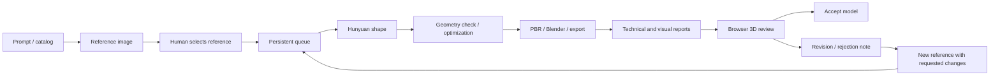

# Local Asset Studio

**Local text-to-image-to-3D asset production, with a browser workbench and human approval.**

Design a reference, choose what to build, run a persistent production queue, and review the resulting 3D model in your browser. Inference runs on your own machine through ComfyUI, Hunyuan3D and Ollama. Other computers on the same trusted LAN can use the web interface.

> **A CUDA-capable NVIDIA GPU with at least 24 GB of dedicated VRAM is required for the supported full pipeline.** The development machine uses an RTX 3090 24 GB on Windows 11. Lower-VRAM and CPU-only end-to-end production are not validated or supported configurations. The VLM step requires approximately 19,000 MiB of free VRAM; close other GPU-heavy applications.

[Türkçe README](README.tr.md) · [Installation](docs/INSTALLATION.md) · [Usage](docs/USAGE.md) · [Architecture](docs/ARCHITECTURE.md) · [Third-party notices](THIRD_PARTY_NOTICES.md)

## What it does

- Create new assets from Turkish/English prompts or your own optional catalog.
- Iterate on reference designs through prompt and component changes; select references for 3D production.
- Run manual 3D selections and review-driven regenerations in one persistent, reorderable queue.
- See the active asset, actual stage, measured stage time, pending items, and failure reasons.
- Remove waiting work or pause after the current job; jobs continue when the browser is closed.
- Generate shape, optimize polygon counts, generate PBR, process meshes in Blender, and export delivery files.
- Rotate, zoom, inspect wireframe/clay views, accept, request revisions, or reject models in the browser.
- Treat human model acceptance independently from technical validation. Raw geometry or a technically blocked model can be accepted without fabricating a PASS or a completed delivery package.
- Preserve old outputs and link each revision to its source model and review note. A review creates at most one automatic regeneration; failed work is not retried indefinitely.



Ordinary references require human selection. Revision/rejection notes explicitly authorize a new candidate to proceed automatically. Reference semantic gates are bypassed in the web human-selection flow; file/mask integrity, GPU ownership, downstream geometry checks, technical validation and final reports remain active. CLI workflows retain their own policies.

## Stack and hardware

| Component | Configuration used in development |
|---|---|
| Operating system | Windows 11; other platforms are not validated |
| GPU | **NVIDIA RTX 3090, 24 GB VRAM — 24 GB minimum for the supported full workflow** |
| System memory | Development host has approximately 48 GB RAM |
| Core runtime | Python 3.12.11, PyTorch 2.6.0 + CUDA 12.6 |
| Geometry / texture | Hunyuan3D 2.1 through a pinned ComfyUI integration |
| Reference providers | Z-Image-Turbo BF16, Qwen-Image-2512 FP8, DreamShaper 8 |
| Visual evaluation | Ollama; configured local tag `qwen3.6:27b` |
| Prompt / revision translation | Local `qwen3:4b`, CPU-only |
| Mesh processing | Blender 5.0.1, PyMeshLab, trimesh |
| Workbench / queue | Flask, SQLite, local Three.js viewer |

GPU work is serialized. Shape, image generation, paint and VLM models are not intended to remain resident simultaneously. Model weights and Python/ComfyUI environments are large and are **not included** in this repository.

The modern image runtime is separate from the pinned Hunyuan runtime. Its existing development environment uses PyTorch 2.10.0 + CUDA 13.0; do not install its requirements into the Hunyuan environment. See the installation guide for the external runtime paths and model-file configuration.

## Getting started

This is a source release of a working local installation, **not a portable executable or a one-click installer**. You need to install the external runtimes, obtain model weights under their respective licenses, and configure paths. A clean-machine GPU installation has not been certified.

```powershell
git clone https://github.com/CakarK/localassetstudio.git
cd localassetstudio

# Inspect docs/INSTALLATION.md and sources.lock.json before running setup.
# Downloads large Hunyuan/DINO model files and installs the isolated core environment.
.\AI3D\Scripts\setup.ps1 -Python312 3.12.11
```

Configure the image-provider model paths in `AI3D/Config/image_providers.json`, prepare the separate image ComfyUI runtime, and install the local Ollama models described in the installation guide. The local VLM tag and digest must match your installation; an existing custom tag is not assumed to be downloadable from the Ollama library.

Once dependencies and weights are ready, run these from the project root:

```powershell
.\Start-AI3D.ps1 -NoBrowser
.\Start-ImageProviders.ps1 -NoBrowser
.\Start-AssetStudio.ps1 -NoBrowser
```

| Service / page | Default address |
|---|---|
| Asset workbench | http://localhost:8088/ |
| Live production queue | http://localhost:8088/queue |
| 3D model review | http://localhost:8088/reviews |
| Hunyuan ComfyUI | http://127.0.0.1:8190 |
| Image ComfyUI | http://127.0.0.1:8191 |
| Ollama | http://127.0.0.1:11434 |

The studio generates a local access code in `AI3D/State/web-access-code.txt`. For another computer on the same LAN, open `http://<server-LAN-IP>:8088`. `Enable-AssetStudioLAN.ps1` can create the private-network firewall rule. Keep the inference services on localhost. This workbench is intended for a trusted LAN; internet hosting, TLS and multi-user identity management are not included.

## Production and review

1. Create an asset or select an entry from your own catalog. Describe the reference you want.
2. Generate a reference and change the prompt as needed. Ordinary reference generation is not a background image queue.
3. Select suitable references, add them to 3D production, and start the queue.
4. Use `/queue` to see names, notes, actual stages and failures. Reorder or remove waiting work there.
5. Open `/reviews` to inspect the GLB and record your decision. Technical failures and VLM scores are informational for your acceptance decision; missing/changed files and active mutation still prevent an unsafe/stale decision.
6. A revision or rejection note creates a new candidate using the existing generation pipeline. It does not perform exact local surgery on the old mesh. The previous output remains intact.

The default asset policy requests **object geometry only**: no terrain tile, ground patch, base plate, plinth or pedestal, including for buildings and trees. Generative models can still violate this request; downstream reports and human review remain necessary.

## Outputs and limits

Successful deliveries can contain GLB, FBX, OBJ, Blender files, albedo/roughness/metallic maps, LOD exports, PNG previews and JSON reports. The exact contents depend on which stages completed. Normal/AO maps are not claimed when absent. A raw accepted model remains technically incomplete until its remaining work has actually succeeded.

Generated data stays under `AI3D/Outputs`; SQLite state, logs and quality reports are local-only. Generated assets, model weights, machine credentials, development databases and Unreal pilot projects are excluded from this repository. No assets are automatically imported into your Unreal project.

Automatic decimation/UV work is not manual retopology. Fine details, exact object identity, requested changes and LOD appearance require inspection. Human acceptance never rewrites an AI or technical failure into a PASS. A previously tested isolated Unreal import does not guarantee compatibility with every engine/project configuration.

## Development

Run the existing tests with an environment containing the locked Python dependencies:

```powershell
.\AI3D\.venv\Scripts\python.exe -m unittest discover -s tests -v
```

Source-release verification: **290 tests passed, 9 optional installation/evidence checks skipped** (299 discovered). No private evidence files or external runtime source are bundled.

Tests use isolated fixtures and mocked inference; passing them does not prove that your GPU models, Blender or ComfyUI installation are configured. Do not run integration tests that acquire the global production lock while real production is active. See [CONTRIBUTING.md](CONTRIBUTING.md).

The implementation keeps the legacy `ai3d_manager` module and launcher names for compatibility. The project and web application are named **Local Asset Studio**.

The public distribution contains **no game catalog, game prompts, shared art direction, character names or game grid settings**. It opens in custom-prompt mode with an empty catalog. Enter your own optional style and negative prompt in the web form. An optional JSON catalog can be selected with `LAS_CATALOG_PATH`; see [catalog configuration](docs/INSTALLATION.md#your-own-catalog).
